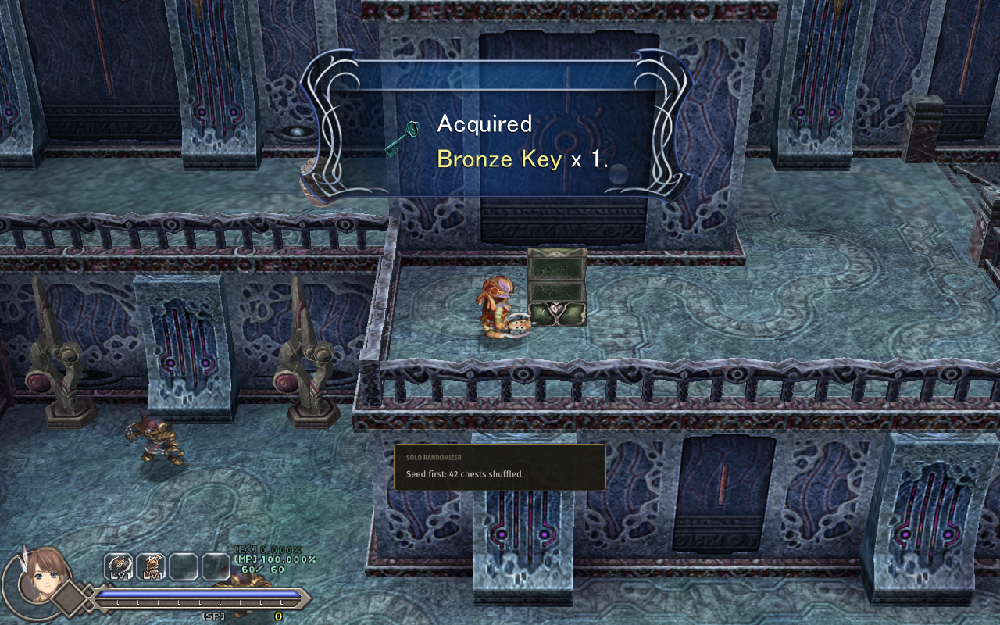

# Solo Randomizer

For **Ys Origin** on CleriaCore. Shuffles what the tower's chests hold, **from a seed, with no server**. A new game
is always beatable: keys, medallions and gear are placed with the tower's own logic. Give your seed to a friend to
race the same layout.



- **42 chests are shuffled** (41 for Toal): keys, boss medallions, moon crests, armor, leggings, accessories,
  Panaceas and Roda Fruits trade places.
- **What stays put:** skill gems, Cleria Ore and SP chests (their chests do more than hand over an item), and
  everything a person gives you (the altars' skills, Roo trades, story items).
- **A seed is any text.** Set it in **F1 > Mods > Solo Randomizer** before starting a new game; leave it empty for a
  random one. The same seed and the same character always give the same layout.
- The layout is stored with the save. A save started without the mod stays as it was.
- *Write the spoiler* on the same page lists every shuffled chest and what it holds.

## Install

1. Download `4rtefakt.solorando-1.0.0.cleriamod` from the [releases](../../releases).
2. Double-click it (or use F1 > Mods > *Install a mod file...*).
3. Turn **Solo Randomizer** on in F1 > Mods, restart CleriaCore, and start a **new game**.

Works with a CleriaCore of mod API 3 or newer.

## How it works

Three parts:

- **[data/](data)**: the tower as a graph, one file per character: 146 regions, 172 passages with their rules
  ("needs the Bronze Key", "needs the double jump"), and every chest and gift with its rule and its item. It is
  built by [.dev/build_data.py](.dev/build_data.py) from the logic of the
  [Ys Origin Archipelago apworld](https://github.com/4rtefakt/ys-origin-archipelago), which exports it as plain data.
- **[fill.lua](fill.lua)** (120 lines): seed -> layout. The items a rule asks for are placed first, each into a
  chest that can be reached while every item still to place is assumed owned; the rest goes wherever is left. The
  result is then walked from nothing: if a chest or the summit can not be reached, the try is thrown away and the
  next one starts. One try runs per game tick, so a new game has its layout in a fraction of a second.
- **[main.lua](main.lua)** (140 lines): the game side. The chest's own script still runs; the grant filter swaps
  what it gives, what rises from the chest and what the box says:

```lua
cleria.content.add_filter(function(q)
    local c = layout[q.room .. "/" .. q.script:upper()]         -- e.g. "S_1001/S_BOX01"
    if not c or q.index ~= c.old then return nil end
    if q.kind == "store" then
        cleria.content.give(c.new, 1, "solorando")
        return "suppress"
    end
    if q.kind == "icon" then return {action = "replace", index = c.new} end
    if q.kind == "window" then
        return {action = "replace", index = c.new, text = cleria.content.treasure_text(q.text, G.item_name(c.new), 1)}
    end
end)
```

| Part | API |
|---|---|
| Swapping a chest | `cleria.content.add_filter` (`store`, `icon`, `window`), `content.give`, `content.treasure_text` |
| The data | `cleria.read` and `cleria.json.decode` on files of the mod; `require("fill")` |
| The layout kept with the save | `cleria.save.set("layout", table)` |
| Work spread over ticks | the `tick` event (a call has an instruction budget) |
| Seed, spoiler | `cleria.ui.page` (a text field, a button), `cleria.data.write` |

## Tests

`python .dev/run.py` runs six cases through CleriaCore's headless harness:

- **204 layouts** (three characters, 68 seeds) are generated by the mod inside the engine, printed, and **re-checked
  by a second implementation in Python** against the same data: the right items, each once, and everything
  reachable from nothing. All 204 are beatable.
- The same seed gives the same layout on a second run.
- In the game, the tower's first chest is made to hold the Bronze Key: the key rises from it, the box reads
  "Acquired Bronze Key x 1", the inventory has the key and no Panacea (the capture above).
- A new game's layout survives a save and load; a new game with no seed picks one.

What that does not cover:

- **Nobody has played a seed to the end.** "Beatable" means beatable according to the logic data. That logic was
  corrected many times during a real Archipelago run, and a few jumps on floors 18 to 25 are still marked as
  suspect there; if a seed asks for a jump you can not make without the Gold Bracelet, that is the cause.
- Only one chest swap was exercised in the engine. Armor and leggings go through the same call but were not opened
  in a test.

## About

Written with AI assistance (Claude Code) as a showcase of the CleriaCore mod API, and tested as described above.
MIT license.
